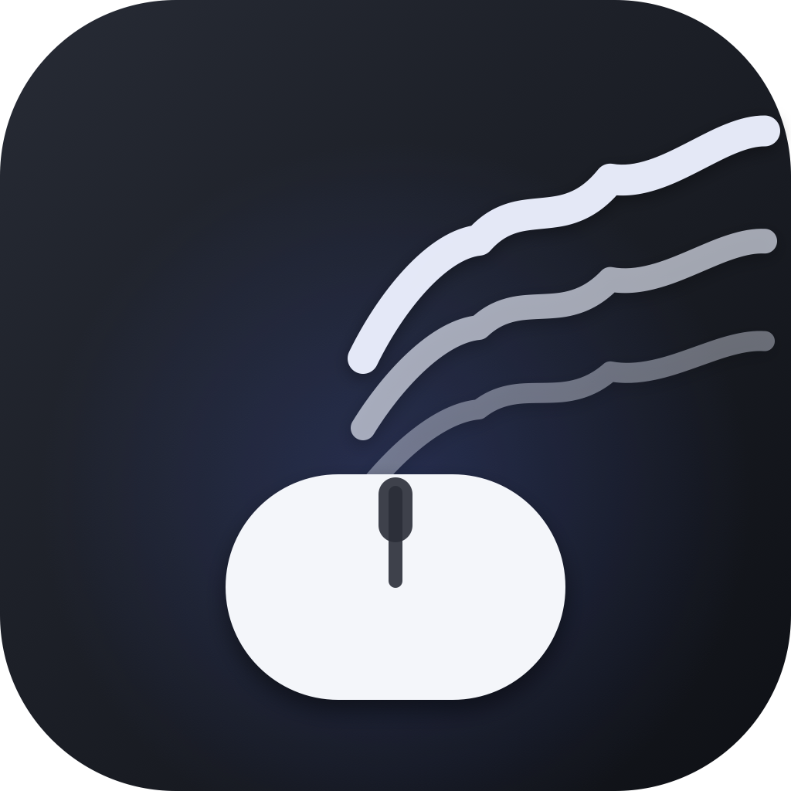

# AirClick

<div align="center">



### The next input revolution isn't on a screen — it's in the air.

**Control your whole Mac with your bare hand.**
Pinch to click · pinch and hold to drag · thumb + middle to right-click.
No gloves, no rings, no hardware, no cloud — just the camera you already own.

</div>

## This is touch, reinvented

Every revolution in human input did the same thing: it moved the interface
closer to the body. The mouse put pointing on every desk. Multi-touch put
the finger on the glass. **AirClick is the next step — it takes the very same
pinch your fingers already know (press, hold, drag, right-click) and lifts it
off the screen: into the air, onto every window, on every app on your Mac.**

Not an accessibility bolt-on. Not a gimmick demo. A **general-purpose,
system-wide pointing device** running 100% on-device (Apple Vision, 21 hand
joints — nothing ever leaves your machine), set up in **one command**, built
from **code you can read**:

- 🙌 **Zero hardware** — your hand is the device. Any built-in or external webcam.
- 🖥 **Zero boundaries** — it moves the *real* system pointer, so it works
  wherever a mouse works: browsers, editors, design tools, games, menus.
- 🔒 **Zero cloud** — no account, no telemetry, no uploads. Ever.
- 📖 **Yours to use** — free for everyone: copy it, build it, modify it, share
  it (CC BY-NC 4.0). What's not allowed: reselling the work itself. A new way
  to touch computing should be born **for everyone.**

## For developers, have fun with the engineering

The entire desktop app — camera pipeline, 21-joint Vision hand tracking, the
gesture state machine, CGEvent injection — is **one Swift file**. No
frameworks. No packages. One `swiftc` command and you're holding an app that
drives your mouse. And inside that file is a stack of interaction engineering
that actually took the work:

- **Pinch detection done statistically** — distances are ratios to the palm
  width (hand size- and distance-to-camera invariant), with hysteresis
  (touch 0.18 ↔ release 0.54), transition debounce and button **mutual
  exclusion**, so a jittery hand can't chatter clicks or crossfire
  right-presses mid-drag. Click needs the fingertips **actually touching**
  — well below the relaxed-hand hover zone — so a lazy hand can't fire
  phantom clicks.
- **Absolute pointer mapping** — the cursor sweeps the whole screen while
  your hand travels the **central 60% of the camera's view**: a small arc,
  every border reachable, and the unreliable outer frame edge never enters
  the math. Where your hand is inside that window, the pointer is — no gain
  curve, no accumulator, nothing to drift, so pausing rests exactly. An
  exponential smoother plus a 2.5 px dead band absorb tracking jitter.
- **The tap-freeze** — a closure-velocity detector notices a deliberate
  pinch tap and freezes the cursor for that instant, so the press lands
  exactly where you aimed. The press is still evaluated during the freeze.
- **Crash-safe by invariant** — every teardown path (hand lost >1.2 s,
  recalibrate, camera off) releases any held buttons. The system pointer
  can never be left stuck down.
- **TCC knowledge baked in** — the Accessibility grant, its cdhash pitfall,
  and the certificate-based fix ship as a script you run once.

The web demo does the same tracking in the browser: React 19 + MediaPipe
Tasks-Vision, synthetic pointer events with `elementFromPoint` targeting.

One file, zero deps, and the pointer physics is the hard-won part.
**Read it in one sitting and steal the good bits.** (`native/main.swift`)

## Desktop app (macOS) — the real thing

```bash
git clone https://github.com/MarkusProgra/AirClick.git
cd AirClick/native
./build.sh        # compiles + signs AirClick.app (needs Xcode Command Line Tools)
open AirClick.app
```

No Xcode? macOS will offer to install the tools on first compile, or run
`xcode-select --install` yourself.

**First run — two permissions:**

1. **Camera** — allowed via the standard prompt. Hand tracking stays on-device.
2. **Accessibility** — System Settings → Privacy & Security → Accessibility →
   switch **AirClick** on. Without it macOS silently ignores every mouse
   movement and click, and the HUD banner keeps telling you so.

**Use it:**

- **Calibrate** — hold your hand centered in view, fingers spread, ~1.5 s.
- **Pinch thumb + index** — left press; **stay pinched to drag**; open to release.
- **Pinch thumb + middle** — right press/drag/release, same hold mechanic.
- The cursor sits at the **pinch point** (midway between thumb and index tip),
  so pinching never shifts it.
- **Pointer feel** — *absolute*: the camera frame maps onto the screen, so
  reaching a corner is just moving your hand there. Moving the hand holds the
  cursor at its spot; nothing drifts and nothing can get "out of range".
- **Tap freeze** — when your fingers deliberately tap together, the pointer
  holds still for that moment, so the press lands exactly where you aimed.
- Menu-bar panel: Recalibrate / Show. When AirClick is active the panel
  compacts (the camera preview hides) — recalibrate to bring it back full.

**Make the grant permanent (optional, once):**

```bash
bash make-signing-cert.sh   # creates a self-signed "AirClick Dev" identity
open AirClick.app           # then toggle Accessibility OFF→ON one last time
```

After that, every rebuild keeps its Accessibility grant — ad-hoc builds
(rebuilt without the identity) re-key it to the binary and you'd re-toggle
each time. `build.sh` picks the identity up automatically.

## Web app (demo) — in-page cursor only

```bash
npm install
npm run dev      # → http://localhost:5174
```

Note that a browser page can neither move the real system pointer nor send
trusted clicks — the web build steers a **virtual cursor inside its own page**
and dispatches synthetic events. It's the demo of the tracking/gestures part;
the desktop app is what actually controls your Mac.

## Web app (in-page cursor)

```bash
npm install
npm run dev     # http://localhost:5174
```

`localhost` is a secure context, so `getUserMedia` works over plain HTTP — no certificate warnings.

The camera stays **off** until you opt in, then:

1. **Calibrate** — hold your hand centered in the viewfinder, fingers spread, thumb out for ~1.5 s.
2. **Point** — your index fingertip becomes the cursor (hand offset amplified to cover the whole window).
3. **Left click** — pop your thumb out past its calibrated baseline.
4. **Right click** — raise your middle finger; the AirClick menu opens (Recalibrate / Re-center / Stop camera).
5. **Recalibrate anytime** — press `R`, the topbar button, or the air menu; re-center without recalibrating with `C`.

Keyboard/mouse shortcuts work throughout: `R` recalibrate, `C` re-center, `Esc` stop, `Enter` start.

## Honest limitation (web)

Browsers don't let a page move the real system pointer or send trusted clicks. The web app moves a
**virtual cursor inside the page** and dispatches synthetic (untrusted) pointer/click events, so
it clicks this page's own UI with real `elementFromPoint` targeting — but not other apps or tabs.
The desktop app exists to close that gap.

## Stack

- **Web**: Vite + React 19 + TypeScript; MediaPipe HandLandmarker (@mediapipe/tasks-vision, GPU
  with CPU fallback) for 21-point hand tracking; CSS Modules; Poppins via @fontsource.
- **Desktop**: single-file Swift (`native/main.swift`) on AppKit + AVCapture + Vision; no
  third-party deps; CGEvent pointer/click injection.

## Repository

This folder is the git repo (branch `main`, remote `origin` →
`git@github.com:MarkusProgra/AirClick.git`; push with `git push`). `node_modules/`,
`dist/`, and the built `native/AirClick.app/` are gitignored and recreated by
`npm install` / `./build.sh` — the repo itself is only source. The git identity here
is repo-scoped (`markusmac2 <markusmac2@users.noreply.github.com>`); change it for
this repo only with `git config user.name …` / `git config user.email …`.

## License & credits

Made by **Markus Hoffmann** — [markushoffmann.dev](https://markushoffmann.dev) ·
[GitHub](https://github.com/MarkusProgra).

Licensed under [CC BY-NC 4.0](https://creativecommons.org/licenses/by-nc/4.0/)
(full legal text in [`LICENSE`](./LICENSE)) — free for anyone to **use, copy,
modify and share**, with attribution — but **not for commercial use**: nobody
gets to sell AirClick or derivatives of it as their own product.
